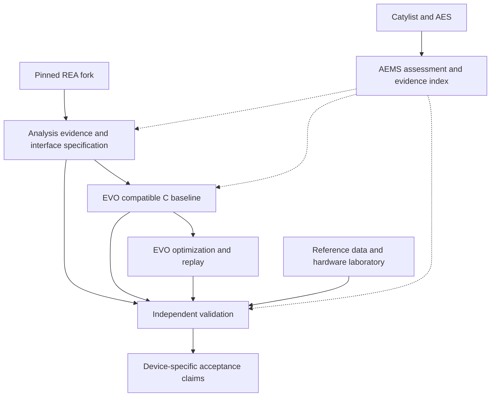

# REA ingestion plan for EVO equipment-preservation capability

- Date: 2026-10-23
- Updated: 2026-10-26 (America/Los_Angeles)
- Status: Owner-directed placement under EVO; detailed contracts and implementation remain open
- REA commit: 9e22da845bf8b447f81539e0ba57d5deb59e9103
- Existing records: REA / PRJ-8, EVO / PRJ-7, documentation-mining task TASK-38, and [EVO #132](https://github.com/dlworrell/evo/issues/132)

See [the integration workspace](REA-EVO-INTEGRATION-WORKSPACE.md) for the isolated branch, pinned checkouts, integration options and delivery sequence. This repository copy brings the prior ingestion plan into EVO review; the draft does not itself qualify an implementation.

## Owner direction and current baseline

On October 26, Donovan directed that REA be integrated into Catylist as part of the EVO capability. This resolves the earlier open question about the companion integration's owning repository: EVO owns it. Catylist records the ecosystem relationship; AES owns applicable requirements; AEMS assesses and indexes evidence. The REA fork remains an external-reference dependency in the current authoritative inventory.

The REA default tip still matches the original reviewed commit above. EVO's inspected default tip is `9a2bce1ca7d9da31f84e93f2f7f6c7f30664bdb2`. Catylist ADR-0007 is now Accepted; its repository/scope implementation qualification remains open. TASK-38 is In progress, with partial source mining and wider history/CI criteria still open.

Direct EVO child-issue reads show #67 and #114 closed as completed; #93, #68, and #69 remain open. The current versioned roadmap and roadmap issue #38 contain stale next-boundary/checklist statements. Use the live child state and actual source when reconciling dependencies. These observations do not independently reproduce provider execution or qualify the installed product.

[EVO #132](https://github.com/dlworrell/evo/issues/132) tracks the integration's ordered acceptance work. This revision records the placement direction and work backlog; repository relationship/contract PRs, implementation, and executable acceptance remain to be delivered. The original October 23 source-review limits and historical deliverables remain attributable to that review.

## Integration decision and delivery boundary

Use the pinned REA fork as an analysis dependency and build the governed companion integration in EVO through REA's public CLI/MCP and evidence contracts. Separate analysis/specification, compatible implementation, and independent validation. Start with one offline acquisition/data-format pilot, then qualify particular devices and operating conditions with laboratory evidence.

The source handoff is REA analysis → evidence-linked behavior specification → independently verified, buildable C baseline → EVO source optimization → retained comparison and replay. REA pseudocode or assembly is evidence for reconstruction; it does not by itself satisfy EVO's C-project ingestion contract. Other-language analysis remains recovery evidence outside this initial C optimization path.

The existing PRM files supply task procedures. Instrument calibration, uncertainty, deterministic control and machinery safety need additional project-specific acceptance criteria.

Start with Donovan's own artifacts/equipment while making device packages suitable for public contributions. Public specifications, adapters and synthetic fixtures can coexist with private firmware, serial identities, calibration records and captures. Record rights and access per artifact.

## What the source review established

| Observation | Evidence and integration consequence |
|---|---|
| The repository is a public fork of morluto/rea. | GitHub metadata identifies the parent. Preserve upstream history and review the fork delta at explicit commits. |
| The source package identifies itself as rea-agents 6.3.0 and points to upstream. | package.json. An upstream npm package name or latest setup command does not select Donovan's audited fork snapshot. Record source, lockfile, build and package digests. |
| CLI and MCP share application workflows, contracts, domain models and provider adapters. | AGENTS.md and docs/architecture.mermaid. Integrate at these existing boundaries before adding new core abstractions. |
| Evidence already records subject hashes, provider/profile, operation/parameters, raw and normalized results, confidence, authority, limitations, locations and links. | src/domain/evidence.ts. Preserve the native model instead of creating another authoritative observation ledger. |
| Evidence bundles also retain residual unknowns and their relationships. | src/domain/evidenceBundle.ts. Export must preserve identity, history and links. |
| Firmware inspection/extraction already exists, with pinned upstream references and separately supplied tools. | docs/firmware-analysis.md and third_party/README.md. Version banners do not establish the source identity of installed binaries. |
| Firmware capabilities have explicit limits. | The guide excludes raw-flash load profiles, MIPS/PPC/RISC-V decompilation in this milestone, bootloader/device-tree semantics, emulation and hardware capture. Documented real fixture coverage is generated gzip/USTAR/ext4 with a Linux x64 ELF child. |
| Public tool effects are modeled. | src/contracts/toolEffects.ts includes process, filesystem, network, UI and mutation effects. These declarations are useful inputs to isolation policy, not an enforced hardware sandbox. |
| Existing project records can be reused. | PRJ-8 is external-reference / Needs review. TASK-38 is now In progress for unfinished read-only mining; the original review did not complete it. EVO / PRJ-7 owns the integration work tracked in EVO #132. |
| Governance status matters. | ADR-0004 and ADR-0007 are Accepted. ADR-0007 implementation qualification remains open. Crypto/EVO pilot evidence does not qualify REA. |
| AEMS already has inventories, typed graphs, reporting and evidence packaging. | Its README and traceability model preserve canonical ownership with the producer; graph validation does not prove engineering closure. |

This was selected source/document inspection. It did not execute REA, install providers, run tests, compare the complete upstream history, inspect live repository administration or complete TASK-38. No instrument-specific named modules appeared in the recursive path inventory; that bounded discovery does not establish the contents of every source line.

## Ownership and architecture

| Owner | Responsibility |
|---|---|
| Catylist | Governance, repository relationships, lifecycle and decision acceptance. |
| AES | Applicable adopted requirements and any later equipment-profile adoption. |
| AEMS | Inventories, applicability, traceability projections, reporting and deliberate gates. |
| REA | Analysis and native evidence production through the pinned public contracts. |
| EVO | Companion integration, device profiles, interface specs, export mapping, independent compatible implementations, buildable C baseline admission, optimization and replay harnesses. |
| Laboratory / accountable reviewer | Independent references, timing/fault tests and device-specific acceptance. |
| Notion | Existing tasks, owners, dependencies, source revisions, run links and next actions. |

The companion integration belongs to `dlworrell/evo`. Its implementation paths and whether it needs a separate governed top-level scope remain design work. A nested module directory is not a formal ADR-0004 scope. If a governed top-level scope is chosen, declare its owner, class, lifecycle, applicable standards/evidence, dependencies and complete file coverage, then verify actual scope-aware enforcement. Reuse the existing EVO repository.

Keep REA's present external-reference classification until an authoritative decision changes it. Maintaining core fork changes requires explicit ownership, classification, applicable controls and upstream update policy.

Keep AI/MCP orchestration outside real-time control and protective interlocks. Device access belongs behind a bounded local interface with an actual isolation mechanism, explicit device/command scope and timeout/limit policy. Classify commands by effects; a query-shaped command can still initiate acquisition or alter state.

## Prompt sequence

| Stage | Existing prompts | Concrete application and output |
|---|---|---|
| Reconcile | PRM-0068 | Read PRJ-8/TASK-38, its mining protocol, existing evidence and current decisions; preserve assignments and gaps. |
| Inventory | PRM-0022 | Inspect this open-source project normally: architecture, public contracts, providers, dependencies, install paths, tests and CI. Produce a pinned capability matrix. |
| Compare upstream | PRM-0067 | Compare explicit fork/upstream commits and merge base; separate behavior, packaging, dependency and build changes. Produce a reproducible delta and update policy. |
| Review trust boundaries | PRM-0047 | Trace untrusted artifacts, parsers/extractors, subprocesses, output paths, network/UI/device effects and trusted CI. Produce an execution/isolation plan. |
| Set up when needed | PRM-0020 | Prepare the exact installation/configuration plan for an accessible host and audited build. Verify live package/catalog/provider identity rather than registration alone. |
| Recover an interface | PRM-0017/0018/0019/0025/0026/0027; PRM-0044/0045 for drivers | Use existing manuals/source first and investigate only undocumented behavior. Produce evidence-linked interface, file-format or ABI rules. |
| Build a compatible slice | PRM-0028/0029, or PRM-0024 for one rule | Implement a narrow independent parser/library/driver interface with explicit assumptions. |
| Compare and retain unknowns | PRM-0030 + PRM-0068 | Retain independent expectations, actual results, mismatches and not-run cases; update the next question. |
| Qualify a device claim | Additional metrology/timing/safety criteria | Use reference measurements, defined operating conditions and attributable acceptance beyond the generic PRMs. |

A template cannot add missing engine capabilities. Raw MCU/load-profile or architecture work must become an explicit supported-provider/adaptor task before promising analysis of a PLC or controller image.

## Intake and review units

1. Reuse TASK-38 for its read-only intake scope and retain a run with exact source/history/test/CI limits. Do not close its wider acceptance criteria from this selected review.
2. Record full REA commit/tree, upstream comparison base, package/lockfile and every relevant dependency/submodule/provider identity. Preserve per-component license/copyright records.
3. Review package hooks and full relevant workflows before running them. The inspected CI segment uses version-tagged actions; any adopted pinning requirement needs a disposition and full-workflow review.
4. Determine standard applicability by surface. TypeScript orchestration and native C/C++ are different inspection surfaces; external-reference exclusions are deliberate AEMS behavior.
5. Reuse adopted controls. Keep experimental equipment checks and proposed policy mechanisms distinct from adopted AES obligations.
6. Keep the fork delta small; add an export adapter only if public outputs cannot support the mapping. Upgrade through explicit contract/provider/replay regressions.
7. Use approved trusted signing/attestation mechanisms where an adopted requirement applies. Hash identifiers alone establish neither operator authenticity nor measurement truth.

Make implementation review units small: intake/relationship documentation; export adapter and source-derived fixtures; one offline device package; later hardware qualification. A documentation proposal cannot complete those implementation units.

## Common evidence and equipment metadata

Preserve native REA bundles unchanged. Its Evidence envelope is strict, so put versioned equipment/run metadata alongside it and reference exact IDs and retained bytes/digests.

| Linked metadata | Purpose |
|---|---|
| Device model, hardware revision, private serial/asset identity, firmware and host-driver version | Bind a claim to an actual configuration. |
| Capture/manual/source identity, revision and digests | Reproduce what was inspected and the rule's origin. |
| Transport, command/response schema, register widths/endianness/access effects | Keep documented protocol and undocumented extensions explicit. |
| Units, ranges, resolution, scaling and numeric representation | Prevent dimensionally wrong but plausible readings. |
| Original calibration bytes/digest, coefficient revision, provenance and validity | Preserve the instrument's calibration state without inventing authority. |
| Acquisition-time semantics, clock, cadence, sequence and status | Distinguish measurement timing from transport delay and stale samples. |
| Reference identity, calibration chain, uncertainty and environmental conditions | Support a bounded measurement claim. |
| Requirements/cases, expected/actual results, tolerances, unknowns, reviewer and access scope | Preserve compatibility, measurement, safety and attribution evidence separately. |

Retain REA's observed/derived/inferred confidence, authority, limitations and unknowns. Do not collapse these into a blanket verified state. A complete extraction result describes the configured extractor operation; it does not establish complete reconstruction.

Use AEMS's existing artifact classes, qualified identities and relationship types. Validate the projection against schemas/aems-traceability-v1.schema.json and the semantic validator. Canonical observations stay with their producer. An unsupported mapping is a contract gap requiring review, not permission to add fictitious fields or a second database.

Notion links those identities/evidence while preserving human-owned assignments and priorities. The draft AEMS traceability contract and unadopted CAT-CON-001 closure proposal do not establish truth or closure.

## Specialized workstreams

| Workstream | Reuse and new work |
|---|---|
| Firmware / bootloaders | Reuse extraction and supported native-child analysis; add raw MCU load/memory maps or architectures only with explicit verified support. |
| Drivers / legacy OS | Inspect supplied ABIs and recover host transport behavior. Favor a user-space replacement where feasible; use controlled offline VMs only when necessary. |
| Protocols | Start with the exact documented SCPI/GPIB/Modbus/CAN/serial/Ethernet variant. Separate transport from application semantics and vendor extensions. |
| Hardware register profiles | Record width, endianness, read/write effects, reset/state dependencies and datasheet/firmware evidence. |
| Calibration / acquisition formats | Preserve originals; recover units, coefficient use, status, validity and timestamps; define reference/uncertainty claims. |
| Compatible software | Implement from the interface/behavior spec and document licensed reuse/source exposure. Formal clean-room claims require an actual separated process. |
| Hardware validation | Reference measurements, timing, fault/limit tests, restoration and accountable acceptance for the actual device. |

These are coordinated packages/workstreams, not claims that REA already implements each one.

## First pilot: offline acquisition replay

Choose one saved acquisition trace or data/calibration export with suitable documentation and analysis rights. No particular instrument or real capture has been selected.

Scope one command/record type and its decode to value, unit, status and timestamp. Use a documented format directly; use REA only for an unresolved step in a host application/driver or parser.

Retain the input manifest, unchanged raw bytes/calibration export, interface spec, independent decoder, comparison report, AEMS projection and proposed work-hub run update.

Acceptance criteria:

1. Replay is deterministic for stated inputs/state, with unchanged originals.
2. Widths, byte order, units, scaling, range/status and timestamp meaning are explicit.
3. Expected results come from independent original captures/manual cases or a separately derived oracle. Synthetic-only evidence is labeled synthetic.
4. Meaningful negative cases cover truncation/corruption, wrong scaling/units, unsupported revision, device mismatch, stale sequence/time and missing/conflicting calibration context where applicable.
5. Missing prerequisites remain unknown/not-run for affected claims. Missing or invalid samples are never quietly converted into valid-looking readings.
6. Claims link exact input, spec, test, output and implementation identities.
7. The result is offline compatibility evidence; hardware accuracy, timing, safety and production qualification remain unestablished.

Source intake and planning can proceed through connected cloud tools while Donovan reviews on iOS. Replay needs actual input artifacts and execution tools; hardware qualification needs the later lab environment.

## EVO integration delivery

| Delivery | Required exit evidence |
|---|---|
| Pinned source intake | TASK-38 coverage, explicit upstream comparison base/fork delta, dependency/provider identities, effects and rights/access dispositions, and retained unknowns. Its read-only source-review boundary remains intact. |
| Owning relationship and handoff contract | Reviewed EVO documentation/ADR and Catylist relationship PRs; implementation placement; lossless references to unchanged REA bundles and versioned companion equipment metadata. Reuse AEMS contracts; unsupported mappings stay contract gaps. |
| Offline compatible baseline | One selected record and independent expected cases; deterministic value/unit/status/timestamp decoding, meaningful negative cases, unchanged originals and exact input/spec/code/test/output identities. |
| C source admission | A licensed, buildable baseline with explicit toolchains, build commands, workloads, numerical/ABI/correctness constraints and resource policies. Missing, corrupt, mismatched or unsupported inputs reject before candidate evaluation. |
| Installed EVO integration | Production providers and installed analyze/evolve/replay/report after #93 and required #68 artifact support; exact baseline/candidate/recipe/patch identities, correctness/security results, benchmark protocol/raw samples and replay evidence. A no-improvement result remains valid evidence but does not establish an improvement claim. |
| Claim-specific acceptance | Separate compatibility, numerical, performance, measurement, timing and machinery-safety claims, each linked to its required evidence. Hardware-dependent claims remain pending until their own laboratory acceptance. |

Intake, relationship documentation, contract work and offline replay can proceed before the installed optimizer is complete. Full installed integration depends on EVO #93 and #68; the separate #69 product-proof obligation remains. Fake/private providers cannot satisfy the installed product proof. Crypto and Gmail-archive evidence retain their own subjects and acceptance records.

The integration backlog is [EVO #132](https://github.com/dlworrell/evo/issues/132). Deliver focused verified-commit PRs rather than treating an issue or this plan as landed repository architecture. Current source review did not implement the integration or run a pilot.

## Separate acceptance claims

| Claim | Evidence required |
|---|---|
| Format/protocol compatibility | Independent original cases, boundaries/errors, version and transport semantics. A codec round-tripping itself is insufficient. |
| Numerical correctness | Evaluated rules, numeric semantics, independent oracle and/or a scoped formal proof. |
| Measurement fitness | Independent reference, calibration chain, uncertainty budget, conditions, range and predeclared decision rule. |
| Real-time suitability | Defined deadlines/loads and timing evidence appropriate to the claimed bounds. Average response time is insufficient. |
| Machinery safety | Hazard analysis, independent protective functions, planned fault/limit tests and accountable device/installation acceptance. |

NIST's traceability policy requires a documented calibration chain contributing uncertainty and states that traceability alone does not guarantee fitness for purpose. Matching a historical driver therefore needs separate measurement evidence before supporting an accuracy claim.

An illustrative later decision rule could use deviation d, expanded uncertainty U(d), and allowed deviation T: accept when |d| + U(d) <= T; reject when |d| - U(d) > T; otherwise report indeterminate. This is a proposed project rule, not a universal standard. Document coverage, correlations, reference contributions and conditions; unknown uncertainty cannot support this acceptance.

Keep emergency stops, protective interlocks and safety controllers independent of experimental host software. Qualify command effects, startup/timeout/power-loss behavior and relevant worst timing conditions in a controlled lab. AI/MCP/cloud coordination does not become a protective or deterministic control path.

## Public contribution model and next action

Make a device package contain identities/versions, interface references, evidence manifests, independently authored code, redistributable synthetic fixtures, expected results, limitations and qualification scope. Private originals can be referenced by digest and access-controlled locator. Sanitized derivatives have their own identities.

Keep ordinary and untrusted PR execution on disposable infrastructure without lab devices/networks/credentials. Hardware work uses a separately scoped controlled environment; public fork-PR workflows must not gain a lab route through self-hosted runners.

Immediate milestone: complete the bounded intake/capability/authority report using PRM-0022 + PRM-0067 + PRM-0047 and TASK-38's mining protocol, then choose one offline trace-to-value pilot.

The companion REA-Ingestion-Handoff.txt retains the original October 23 bounded review/planning task. Use this updated plan and EVO #132 for current placement and delivery requirements. Repository classification is unchanged. Integration architecture PRs, installation, provider execution, pilot implementation and hardware qualification remain open; the current update records owner direction and tracking only.

## Sources

- [Reviewed REA snapshot](https://github.com/dlworrell/rea/tree/9e22da845bf8b447f81539e0ba57d5deb59e9103)
- [Instructions and architecture](https://github.com/dlworrell/rea/blob/9e22da845bf8b447f81539e0ba57d5deb59e9103/AGENTS.md)
- [Architecture map](https://github.com/dlworrell/rea/blob/9e22da845bf8b447f81539e0ba57d5deb59e9103/docs/architecture.mermaid)
- [Package metadata](https://github.com/dlworrell/rea/blob/9e22da845bf8b447f81539e0ba57d5deb59e9103/package.json)
- [Evidence model](https://github.com/dlworrell/rea/blob/9e22da845bf8b447f81539e0ba57d5deb59e9103/src/domain/evidence.ts)
- [Evidence bundles](https://github.com/dlworrell/rea/blob/9e22da845bf8b447f81539e0ba57d5deb59e9103/src/domain/evidenceBundle.ts)
- [Tool effects](https://github.com/dlworrell/rea/blob/9e22da845bf8b447f81539e0ba57d5deb59e9103/src/contracts/toolEffects.ts)
- [Firmware capabilities and limits](https://github.com/dlworrell/rea/blob/9e22da845bf8b447f81539e0ba57d5deb59e9103/docs/firmware-analysis.md)
- [Third-party identities](https://github.com/dlworrell/rea/blob/9e22da845bf8b447f81539e0ba57d5deb59e9103/third_party/README.md)
- [PRJ-8](https://app.notion.com/p/402ae4dd71538120b157dd772d5b363c)
- [TASK-38](https://app.notion.com/p/402ae4dd715381bfa629f893f99e0543)
- [Current onboarding review](https://app.notion.com/p/402ae4dd715381e89ed0c9db29ce6a98)
- [Accepted ADR-0004](https://github.com/dlworrell/Catylist/blob/main/docs/adr/ADR-0004-governed-project-scopes.md)
- [Accepted ADR-0007](https://github.com/dlworrell/Catylist/blob/main/docs/adr/ADR-0007-governed-check-in-and-shared-automation.md)
- [ADR-0007 mirror and pilot history](https://app.notion.com/p/402ae4dd715381a4ae94e9c330ad5c5f)
- [AEMS capabilities and limits](https://github.com/dlworrell/AEMS/blob/main/README.md)
- [AEMS traceability model](https://github.com/dlworrell/AEMS/blob/main/docs/architecture/artifact-and-traceability-model.md)
- [NIST metrological traceability policy](https://www.nist.gov/calibrations/traceability)

Prompt source for the original October 23 review: Dropbox /prompt/REA-PROMPTS-INDEX.txt. The current procedure location is /repo/prompt/ following the October 26 relocation; preserve existing PRM identifiers, filenames and skill directories. PRM-0022, 0027, 0030, 0047, 0067 and 0068 were read directly for the original proposal; remaining referenced procedures were mapped from that review's index and previously authored templates. This placement update does not claim a new execution of those prompts. Source findings and proposed work are distinguished throughout.
